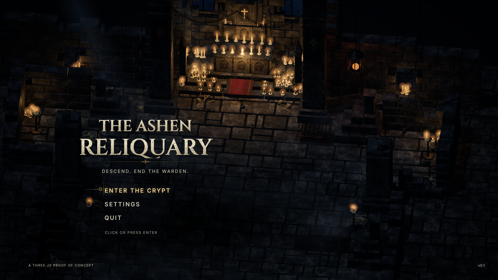
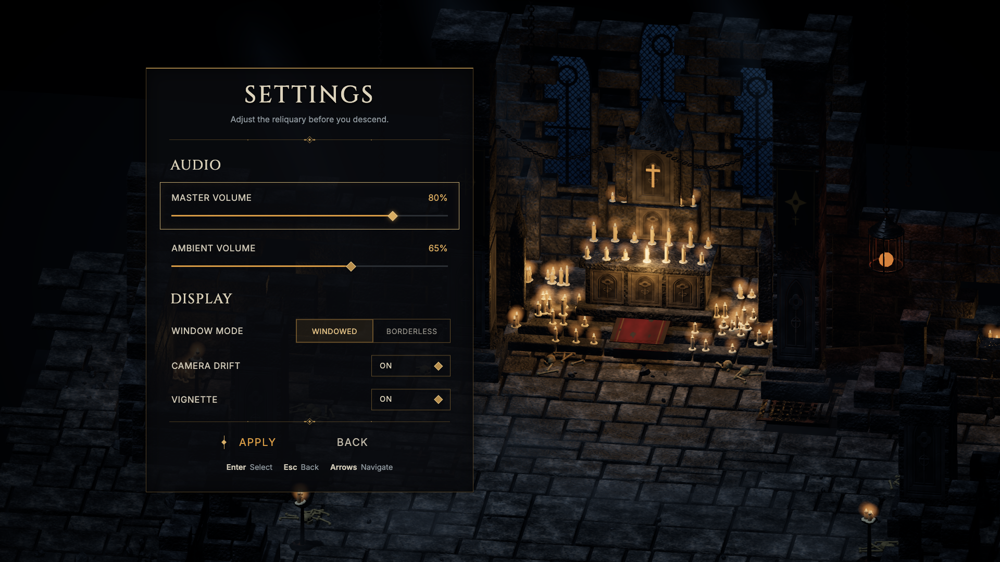
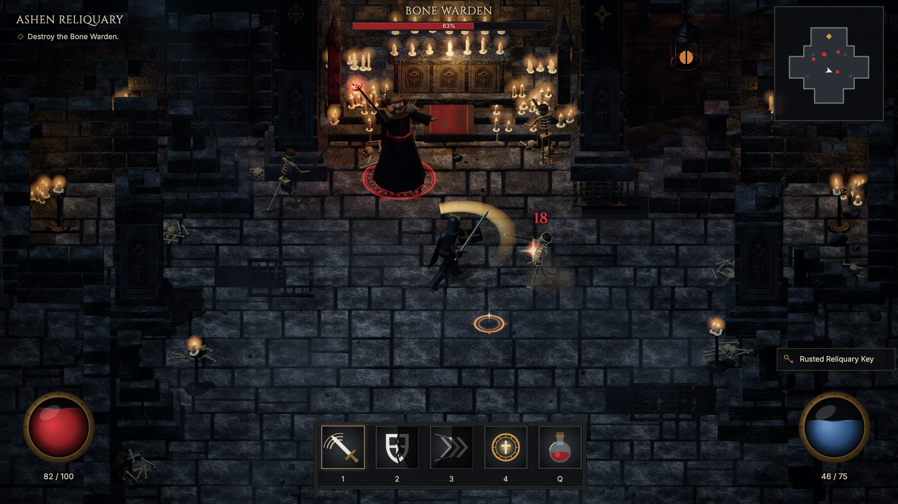

# The Ashen Reliquary — Three.js Edition

A single-room action RPG proof of concept set in a ruined cathedral crypt. A lone grave-warden knight fights the **Bone Warden** and its Skeletal Thralls.

**▶ Play: https://ridermw.github.io/crawler-3js/**

The game ships **no image, model or audio files**. Every texture, normal and roughness map, UI ornament, ability icon, 3D mesh and sound effect is generated in code at startup from a seeded xorshift32 RNG. Output is identical on every load, so the project can be ported one-to-one to a native engine.

| Title | Settings | Crypt |
|---|---|---|
|  |  |  |

## How to play

| Action | Input |
|---|---|
| Move | **WASD** / arrow keys, or **left-click** (hold to steer) on the floor |
| Greatsword Cleave | **1**, **Space** or **right-click** |
| Shield Bash (stun, 12 essence) | **2** |
| Shadow Lunge (dash strike, 18 essence) | **3** |
| Consecration Ward (damage aura, halves damage taken, 30 essence) | **4** |
| Crimson Vial (+35 health) | **Q** |
| Back to title | **Esc** |

Hits restore essence. The Bone Warden casts crimson bolts and summons more thralls; below half health it fires three bolts at a time. Destroy it to win. **Enter** starts a new run after victory or defeat.

Settings (master and ambient volume, window mode, camera drift and vignette) use draft-and-apply: **APPLY** saves them to `localStorage`, and **BACK** / **Esc** throws the draft away.

## Architecture

No bundler and no build step. Three.js r169 loads from a CDN through an import map.

| File | Contents |
|---|---|
| `index.html` | Import map, fonts (Cinzel, Inter), DOM UI layers |
| `style.css` | Title, settings and HUD. Lengths use the reference mocks' 1536×1024 space (`--u`). Centre widgets sit in the 3:2 safe frame; corner HUD widgets anchor to the real screen edges |
| `src/main.js` | Renderer, post-processing (bloom → `CryptGrade` split-tone and vignette), orthographic camera poses, input, state machine, URL harness and telemetry |
| `src/pixel.js` | xorshift32 RNG; value noise, Voronoi, crack carving and height→normal maps; stone, iron, bone, cloth, banner, lancet-window, rune and VFX textures; title lockup, dividers, ability icons, orbs, minimap |
| `src/world.js` | Seeded crypt generator: flagstones, grates, stepped dais, altar and tabernacle, pillars, broken walls, alcoves, balustrades, chains, brazier, rubble and bones (merged per material), instanced candles, moonlight and candle lights, ground fog |
| `src/combat.js` | Jointed low-poly knight, thralls and warden; abilities, cooldowns, AI, projectiles, VFX and the frozen reference pose |
| `src/ui.js` | Title menu, settings draft/apply, HUD bindings, floating damage numbers |
| `src/audio.js` | WebAudio drone, wind, drips and bells, plus combat and UI sound effects |

### Deterministic harness

| Query | Effect |
|---|---|
| `?state=title\|settings\|crypt` | Boot straight into a screen |
| `?freeze=1` | Freeze all animation at the reference keyframe. `crypt` then shows the reference combat snapshot (82/100 HP, 46/75 essence, warden at 63%, cooldown wedges on 2 and 3) |
| `?frame=ref` | Lay the UI out inside the centred 3:2 frame instead of the 16:9 edges |
| `?pass=clay&ui=0&actors=0` | Diagnostic geometry render: uniform matte white, no UI or characters |

`window.__crawler` exposes live telemetry: `state`, `hp`, `essence`, `bossHp`, `cooldowns`, `selectedMenu`, `settings`, `draft`, `player` and `enemies`.

## Visual validation

The three approved reference stills are in `artifacts/mockups/`. The tools in `tools/fidelity/`:

```sh
python3 -m http.server 8000 &
npm i --no-save playwright-core                    # uses the installed Google Chrome
node tools/fidelity/capture.mjs                    # three frozen 1920x1080 captures
python3 tools/fidelity/compare-scene.py --all --print --write-comparison   # v2 gate, see docs/fidelity-gate.md
node tools/fidelity/playtest.mjs                   # full interactive loop, fails on any console error
python3 tools/fidelity/overlay.py artifacts/image-run/crypt/clay.png \
  artifacts/validation/tmp/ashen-reliquary-crypt-clay.png --out overlay.jpg
```

`artifacts/image-run/` holds geometry references made from each mock with `mockui edit`, following the image-run workflow: a tone-matched 4K master, a clean plate with UI and characters removed, a white shadowless clay pass and a depth pass. Prompts, check results and the call ledger are committed; the large PNGs are not. The runtime `?pass=clay` capture is compared against these passes to find layout drift.

## Run locally

```sh
python3 -m http.server 8000   # then open http://localhost:8000
```
